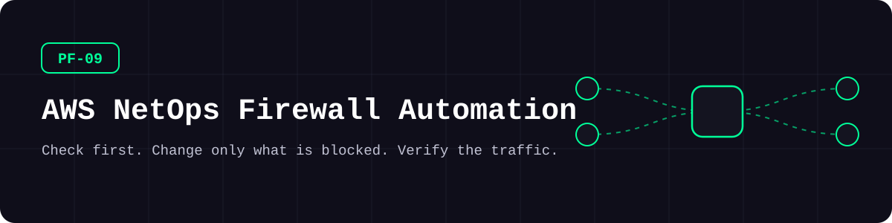
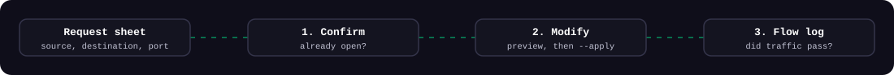
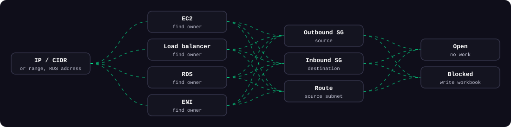
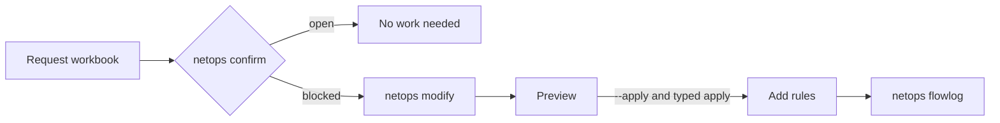

<picture>
  <source media="(prefers-color-scheme: dark)" srcset="docs/assets/banner-dark.svg">
  <source media="(prefers-color-scheme: light)" srcset="docs/assets/banner-light.svg">
  
</picture>

**방화벽 요청이 이미 열려 있는지 모든 AWS 계정에서 먼저 확인하고, 막힌 것만 바꾼 뒤, 실제 통신까지 검증합니다.**

[](https://github.com/kimjhtlzk/pf-09-aws-netops-firewall-automation/actions/workflows/ci.yml)     [](https://github.com/kimjhtlzk/pf-09-aws-netops-firewall-automation/actions/workflows/ci.yml) [](LICENSE)

[English](README.md) | 한국어 · [포트폴리오](https://github.com/kimjhtlzk)

## 한눈에 보기

- **3단계:** 사전 확인, 적용, 사후 검증
- **입력 형식 4가지:** IP, CIDR, IP 범위, RDS 주소
- **리소스 4종 식별:** EC2, 로드밸런서, RDS, ENI
- **기본 동작은 아무것도 바꾸지 않습니다.** 적용하려면 `--apply`와 직접 입력 확인이 필요합니다

## 구조

<picture>
  <source media="(prefers-color-scheme: dark)" srcset="docs/assets/three-steps-dark.svg">
  <source media="(prefers-color-scheme: light)" srcset="docs/assets/three-steps-light.svg">
  
</picture>

<picture>
  <source media="(prefers-color-scheme: dark)" srcset="docs/assets/evaluation-dark.svg">
  <source media="(prefers-color-scheme: light)" srcset="docs/assets/evaluation-light.svg">
  
</picture>



## 데모


## 구성 요소

| 명령 | 설명 | 주요 API |
|---|---|---|
| `netops confirm` | 리소스를 식별하고 규칙·라우팅을 평가 | EC2, ELBv2, RDS |
| `netops modify` | 보안그룹 선택, 슬롯 확인, 미리보기, 적용 | EC2 |
| `netops flowlog` | 실제 통신 기록 조회 | CloudWatch Logs, Athena |
| `netops collect` | EC2, 보안그룹, 로드밸런서, RDS, 라우팅, VPC 자산 수집 | EC2, ELBv2, RDS |
| `netops sso-login` | 모든 계정의 임시 자격증명 발급과 자동 갱신 | IAM Identity Center |

### 전후 비교

| | 콘솔 수작업 | 이 도구 |
|---|---|---|
| IP의 주인 찾기 | 계정마다 검색 | 모든 계정에서 자동 식별 |
| 규칙 존재 여부 | 보안그룹을 하나씩 확인 | 규칙과 라우팅을 함께 평가 |
| 중복 규칙 | 실수로 넣기 쉬움 | 이미 열린 요청은 먼저 제외 |
| 규칙 개수 제한 | 호출이 실패해야 알게 됨 | 남은 슬롯을 미리 확인 |
| 변경 검토 | 화면 캡처 | 영향 범위가 포함된 계획 출력 |

### 안전장치

| 장치 | 동작 |
|---|---|
| 미리보기 기본 | `--apply`가 없으면 아무것도 바뀌지 않습니다 |
| 직접 입력 확인 | `--apply`를 줘도 `apply`를 입력해야 합니다 |
| 슬롯 확인 | 자리가 없는 보안그룹은 고르지 않습니다 |
| TLS 검증 | 항상 켜져 있습니다. 사내 CA는 `ca_bundle`에 지정합니다 |
| 최소 권한 | [`docs/permissions/`](docs/permissions)에 조회용과 추가 전용 정책을 분리했습니다 |
| 추가만 가능 | 이 도구는 규칙을 삭제할 수 없습니다 |

## 폴더 구조

```text
.
├── src/netops/
│   ├── cli.py              # netops 명령
│   ├── resolve.py          # 주소를 AWS 리소스로 식별
│   ├── analyze/            # 보안그룹·라우팅 평가
│   ├── apply/              # 미리보기와 적용
│   ├── flowlog/            # CloudWatch·Athena 조회
│   ├── collect/            # 자산 엑셀 6종
│   ├── io/                 # 엑셀 입출력
│   ├── auth/               # IAM Identity Center 로그인
│   └── aws/                # 세션, 프록시, CA 번들
├── tests/                  # moto 다중 계정 테스트
├── examples/               # 중립 값으로 만든 양식과 설정
└── docs/                   # 사용법, 프록시, SSO, 권한
```

## 빠른 시작

| 도구 | 버전 |
|---|---|
| Python | 3.11 이상 |

```bash
pip install -e ".[demo]"
netops confirm --demo
netops modify --demo
```

<details>
<summary>고급: 실제 계정에서 사용하기</summary>

```bash
pip install -e .
cp examples/config.example.yaml config.yaml
netops --config config.yaml sso-login --role <permission-set>
netops --config config.yaml confirm
```

[사용법](docs/USAGE.md), [SSO](docs/SSO_LOGIN.md), [프록시 설정](docs/PROXY.md)을 참고하세요.

</details>

## 사용 예시

**요청 목록을 확인합니다.**

```bash
netops confirm --file requests.xlsx
```

**막힌 요청의 변경 내용을 미리 봅니다.**

```bash
netops modify --file workspace/modify_from_confirm/FW_Modify.xlsx
```

**실제 통신을 검증합니다.**

```bash
netops flowlog --account svc-a-dev --vpc vpc-00000000 --table example_flow_logs --address 10.0.1.10 --interval 1h
```

## 설계 결정

- **바꾸기 전에 확인합니다.** 막힌 요청만 적용 단계로 넘어갑니다.
- **미리보기가 기본입니다.** 안전한 동작에는 옵션이 필요 없습니다.
- **TLS 검증은 끌 수 없습니다.** 이 호출에는 자격증명이 실립니다.
- **규칙은 추가만 합니다.** 삭제는 통신을 아는 사람이 판단해야 합니다.
- **엑셀을 그대로 씁니다.** 요청이 이미 엑셀로 들어오기 때문입니다.

전체 기록: [docs/DECISIONS.md](docs/DECISIONS.md)

## 보안 고려 사항

- 자격증명은 소유자만 읽을 수 있게 `~/.aws`에 두며, 이 폴더에는 두지 않습니다
- Athena 테이블 이름과 주소는 쿼리에 넣기 전에 검증합니다
- 자리표시자만 사용합니다. [SECURITY.md](SECURITY.md)를 참고하세요
- CI가 push마다 gitleaks(비밀값 탐지)를 실행합니다

## 실무 맥락

금융권 다중 AWS 계정 환경에서 방화벽 요청 처리 시간을 단축하고 중복 규칙과 적용 실패를 줄이기 위해 만든 도구입니다.

## 이번 재구성에서 바뀐 점

| 유형 | 변경 |
|---|---|
| 구조 | 스크립트를 패키지 하나, CLI 하나로 정리 |
| 민감정보 | 조직 이름과 명명 규칙 제거, 자격증명을 폴더 밖으로 이동 |
| 보안 | TLS 검증 활성화, 미리보기 기본, 소유자 전용 자격증명 파일, 쿼리 검증 |
| 테스트·CI | moto 다중 계정 테스트, ruff, mypy, gitleaks |
| **데모용으로 새로 추가** | 가짜 다중 계정 환경을 쓰는 `--demo` |

자세한 내용: [docs/REFACTOR_NOTES.md](docs/REFACTOR_NOTES.md)

## 한계와 다음 계획

- 보안그룹은 자동으로 고릅니다. 계획에 이유를 출력하지만, 다른 그룹을 고르는 메뉴는 아직 없습니다.
- 규칙 평가는 IPv4 대역과 보안그룹 참조를 읽습니다. 관리형 접두사 목록은 평가하지 않습니다.
- Flow Log 조회는 이번 재구성 이후 실제 로그 아카이브로 실행해 보지 않았습니다.

## 만든 사람

**김준현** · 퍼블릭 클라우드 인프라·보안 엔지니어

[포트폴리오](https://github.com/kimjhtlzk) · [LinkedIn](https://www.linkedin.com/in/ihanni/) · [블로그](https://hann-blume.tistory.com/)

## 시리즈의 다른 레포

| 번호 | 레포 | 보여 주는 것 |
|---|---|---|
| PF-01 | [pf-01-aws-terraform-multi-region](https://github.com/kimjhtlzk/pf-01-aws-terraform-multi-region) | `locals` 맵 하나로 만드는 16개 리전 AWS 플랫폼 |
| PF-02 | [pf-02-gcp-terraform-gke-platform](https://github.com/kimjhtlzk/pf-02-gcp-terraform-gke-platform) | SURGE 업그레이드와 기본 차단 방화벽을 갖춘 GKE 플랫폼 |
| PF-03 | [pf-03-tencent-terraform-audit-ready](https://github.com/kimjhtlzk/pf-03-tencent-terraform-audit-ready) | 감사 추적을 COS에 쌓는 Tencent Cloud IaC |
| PF-04 | [pf-04-aws-terragrunt-dry-iac](https://github.com/kimjhtlzk/pf-04-aws-terragrunt-dry-iac) | 실제 의존성 그래프를 가진 DRY Terragrunt 구조 |
| PF-05 | [pf-05-multicloud-asset-audit-automation](https://github.com/kimjhtlzk/pf-05-multicloud-asset-audit-automation) | 3개 클라우드 자산·감사 로그 수집 자동화 |
| PF-06 | [pf-06-aethercrew-ai-company](https://github.com/kimjhtlzk/pf-06-aethercrew-ai-company) | 안전장치를 갖춘 역할 기반 멀티 에이전트 회사 |
| PF-09 | [pf-09-aws-netops-firewall-automation](https://github.com/kimjhtlzk/pf-09-aws-netops-firewall-automation) | 여러 AWS 계정의 방화벽 변경을 확인·적용·검증 |
