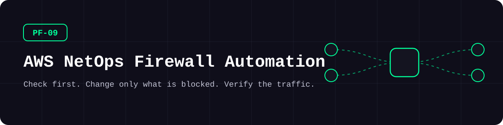
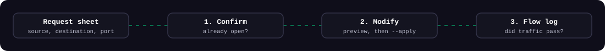
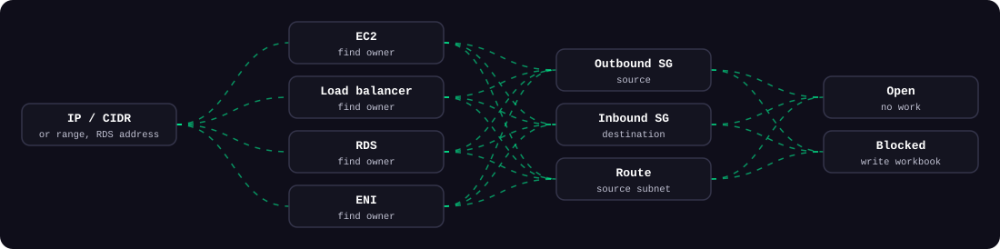
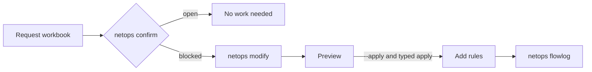

<picture>
  <source media="(prefers-color-scheme: dark)" srcset="docs/assets/banner-dark.svg">
  <source media="(prefers-color-scheme: light)" srcset="docs/assets/banner-light.svg">
  
</picture>

**Check whether a firewall request is already open across every AWS account, change only what is blocked, then verify the traffic.**

[](https://github.com/kimjhtlzk/pf-09-aws-netops-firewall-automation/actions/workflows/ci.yml)     [](https://github.com/kimjhtlzk/pf-09-aws-netops-firewall-automation/actions/workflows/ci.yml) [](LICENSE)

English | [한국어](README.ko.md) · [Portfolio](https://github.com/kimjhtlzk)

## At a glance

- **3 steps:** confirm, modify, verify
- **4 input formats:** IP, CIDR, IP range, RDS address
- **4 resource types identified:** EC2, load balancer, RDS, ENI
- **Nothing changes by default.** Applying needs `--apply` and a typed confirmation

## Architecture

<picture>
  <source media="(prefers-color-scheme: dark)" srcset="docs/assets/three-steps-dark.svg">
  <source media="(prefers-color-scheme: light)" srcset="docs/assets/three-steps-light.svg">
  
</picture>

<picture>
  <source media="(prefers-color-scheme: dark)" srcset="docs/assets/evaluation-dark.svg">
  <source media="(prefers-color-scheme: light)" srcset="docs/assets/evaluation-light.svg">
  
</picture>



## Demo


## What's inside

| Command | Description | Main APIs |
|---|---|---|
| `netops confirm` | Identifies resources, then evaluates rules and routes | EC2, ELBv2, RDS |
| `netops modify` | Picks a security group, checks slots, previews, applies | EC2 |
| `netops flowlog` | Searches real traffic | CloudWatch Logs, Athena |
| `netops collect` | EC2, security group, load balancer, RDS, route, and VPC inventory | EC2, ELBv2, RDS |
| `netops sso-login` | Temporary credentials for all accounts, renewed automatically | IAM Identity Center |

### Before and after

| | In the console | With this tool |
|---|---|---|
| Find what owns an IP | Search account by account | Automatic across accounts |
| Know if a rule exists | Read each security group | Rules and routes evaluated together |
| Duplicate rules | Easy to add by accident | Open flows are dropped first |
| Rule limit | Found out when the call fails | Free slots checked in advance |
| Review a change | Screenshots | Printed plan with affected resources |

### Safety controls

| Control | Behavior |
|---|---|
| Preview by default | Without `--apply`, nothing changes |
| Typed confirmation | `--apply` still asks you to type `apply` |
| Rule slot check | A security group without room is never chosen |
| TLS verification | Always on. A private CA goes in `ca_bundle` |
| Least privilege | Separate read-only and add-only policies in [`docs/permissions/`](docs/permissions) |
| Add only | The tool cannot remove a rule |

## Repository structure

```text
.
├── src/netops/
│   ├── cli.py              # netops command
│   ├── resolve.py          # address to AWS resource
│   ├── analyze/            # security group and route checks
│   ├── apply/              # preview and apply
│   ├── flowlog/            # CloudWatch and Athena search
│   ├── collect/            # six inventory workbooks
│   ├── io/                 # Excel input and output
│   ├── auth/               # IAM Identity Center sign-in
│   └── aws/                # sessions, proxy, CA bundle
├── tests/                  # moto multi-account tests
├── examples/               # forms and settings with neutral values
└── docs/                   # usage, proxy, SSO, permissions
```

## Quick start

| Tool | Version |
|---|---|
| Python | 3.11 or newer |

```bash
pip install -e ".[demo]"
netops confirm --demo
netops modify --demo
```

<details>
<summary>Advanced: use real accounts</summary>

```bash
pip install -e .
cp examples/config.example.yaml config.yaml
netops --config config.yaml sso-login --role <permission-set>
netops --config config.yaml confirm
```

See [USAGE](docs/USAGE.md), [SSO](docs/SSO_LOGIN.md), and [proxy setup](docs/PROXY.md).

</details>

## Usage examples

**Check a list of requests:**

```bash
netops confirm --file requests.xlsx
```

**Preview the changes for the blocked flows:**

```bash
netops modify --file workspace/modify_from_confirm/FW_Modify.xlsx
```

**Verify real traffic:**

```bash
netops flowlog --account svc-a-dev --vpc vpc-00000000 --table example_flow_logs --address 10.0.1.10 --interval 1h
```

## Design decisions

- **Check before changing**, so only blocked flows reach the apply step.
- **Preview is the default**, so the safe action needs no flag.
- **TLS verification cannot be turned off**, because these calls carry credentials.
- **Rules are only added.** Removing one needs a person who knows the traffic.
- **Excel stays the interface**, because requests already arrive that way.

Full records: [docs/DECISIONS.md](docs/DECISIONS.md)

## Security considerations

- Credentials stay in `~/.aws`, written with owner-only permissions, never in this folder
- Athena table names and addresses are validated before they reach a query
- Placeholders only: see [SECURITY.md](SECURITY.md)
- CI runs gitleaks on every push

## Real-world context

Built for a multi-account AWS environment in the financial sector, to shorten firewall request handling and reduce duplicate rules and failed changes.

## What changed in this refactor

| Type | Change |
|---|---|
| Structure | Scripts became one package with one CLI |
| Sensitive data | Organization names and naming rules removed, credentials moved out of the folder |
| Security | TLS verification on, preview by default, owner-only credential file, validated queries |
| Tests and CI | moto multi-account tests, ruff, mypy, gitleaks |
| **New for the demo** | `--demo` with a fake multi-account environment |

Details: [docs/REFACTOR_NOTES.md](docs/REFACTOR_NOTES.md)

## Limitations and roadmap

- The security group is chosen automatically. The plan prints the reason, but there is no menu to pick another one yet.
- Rule checks read IPv4 ranges and security group references. Prefix lists are not evaluated.
- Flow log search has not been run against a live log archive since this refactor.

## Author

**Kim JunHyun** · Public Cloud Infrastructure & Security Engineer

[Portfolio](https://github.com/kimjhtlzk) · [LinkedIn](https://www.linkedin.com/in/ihanni/) · [Blog](https://hann-blume.tistory.com/)

## More in this series

| No. | Repository | What it shows |
|---|---|---|
| PF-01 | [pf-01-aws-terraform-multi-region](https://github.com/kimjhtlzk/pf-01-aws-terraform-multi-region) | 16-region AWS platform from one `locals` map |
| PF-02 | [pf-02-gcp-terraform-gke-platform](https://github.com/kimjhtlzk/pf-02-gcp-terraform-gke-platform) | GKE platform with surge upgrades and a deny-first firewall |
| PF-03 | [pf-03-tencent-terraform-audit-ready](https://github.com/kimjhtlzk/pf-03-tencent-terraform-audit-ready) | Tencent Cloud IaC with audit trails stored in COS |
| PF-04 | [pf-04-aws-terragrunt-dry-iac](https://github.com/kimjhtlzk/pf-04-aws-terragrunt-dry-iac) | DRY Terragrunt layout with a real dependency graph |
| PF-05 | [pf-05-multicloud-asset-audit-automation](https://github.com/kimjhtlzk/pf-05-multicloud-asset-audit-automation) | Asset and audit collection across three clouds |
| PF-06 | [pf-06-aethercrew-ai-company](https://github.com/kimjhtlzk/pf-06-aethercrew-ai-company) | Role-based multi-agent company with safety controls |
| PF-09 | [pf-09-aws-netops-firewall-automation](https://github.com/kimjhtlzk/pf-09-aws-netops-firewall-automation) | Check, apply, and verify firewall changes across AWS accounts |
